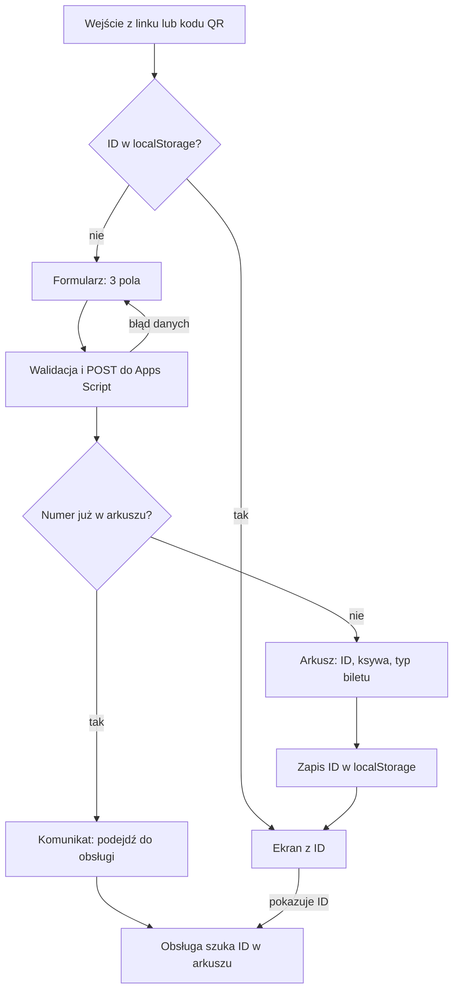

# Rejestracja na wydarzenie, specyfikacja prototypu

Stan na 21.10.2026 · Wojtek Mankowski

## Cel i zakres

Uczestnik wpisuje na telefonie numer zamówienia, imię i pierwszą literę nazwiska. Strona zapisuje dane w arkuszu Google, skrypt dobiera ksywę (podaną wcześniej przy zapisach na sesje) i typ biletu z listy wszystkich biletów, a uczestnik widzi kolejny numer ID (kolumna „Lp”). Obsługa szuka tego ID w arkuszu i sama weryfikuje resztę danych zamówienia.

| Rola | Urządzenie | Co robi |
| --- | --- | --- |
| Uczestnik | Własny telefon, wejście z linku lub kodu QR | Rejestruje się raz, potem pokazuje ekran z ID |
| Obsługa | Komputer lub telefon z dostępem do arkusza | Szuka ID w arkuszu, wpisuje status weryfikacji |

Stos: React + TypeScript (Vite, Tailwind) na GitHub Pages, Google Apps Script jako API zapisu, Google Sheets jako baza danych. Szczegóły są w TECH.md.

## Przepływ uczestnika



Przy pierwszym wejściu uczestnik przechodzi formularz i dostaje ID z arkusza. Przy każdym kolejnym wejściu na tym samym telefonie strona pokazuje ID od razu z localStorage, bez wywołania serwera.

## Wymagania funkcjonalne

| ID | Wymaganie | Źródło |
| --- | --- | --- |
| F1 | Formularz ma trzy pola: numer zamówienia, imię, pierwsza litera nazwiska. Wszystkie są wymagane. Uczestnik nie wpisuje ksywy w dniu imprezy. | Wymaganie |
| F2 | Strona sprawdza dane przed wysłaniem (reguły w sekcji „Walidacja i komunikaty”). Serwer sprawdza je ponownie. | Założenie |
| F3 | Przycisk „Zarejestruj” blokuje się na czas wysyłania, żeby jedno kliknięcie dawało jeden wiersz. | Założenie |
| F4 | Serwer usuwa spacje z numeru zamówienia i porównuje go jako tekst z kolumną „Nr Zamówienia”. | Założenie |
| F5 | Gdy numer już jest w arkuszu, serwer odrzuca zgłoszenie, a strona pokazuje komunikat z prośbą o kontakt z obsługą. Nowy wiersz nie powstaje. | Wymaganie |
| F6 | Gdy numeru nie ma, serwer nadaje kolejny numer ID (kolumna „Lp”: 1, 2, 3…), dopisuje wiersz i zwraca ID. | Wymaganie |
| F7 | Serwer szuka numeru zamówienia na karcie „Bilety” (lista wszystkich biletów) i wpisuje znalezioną ksywę do kolumny „Ksywa”, a typ do kolumny „Typ Biletu”. Gdy numeru nie ma na liście, „Ksywa” zostaje pusta, „Typ Biletu” dostaje „brak na liście”, a rejestracja przechodzi. | Wymaganie (zachowanie przy braku: założenie) |
| F8 | Strona zapisuje w localStorage ID, numer zamówienia, imię, inicjał, ksywę, typ biletu i czas rejestracji. | Wymaganie |
| F9 | Przy ponownym wejściu strona odczytuje localStorage i od razu pokazuje ekran z ID, bez formularza i bez wywołania serwera. | Wymaganie |
| F10 | Ekran z ID pokazuje duży numer ID, „Imię I.”, ksywę, numer zamówienia, typ biletu i instrukcję „Pokaż ten ekran obsłudze”. Działa bez internetu. | Wymaganie |
| F11 | Obsługa wpisuje uwagi w kolumnie „Działanie” (wolny tekst). Strona uczestnika nie czyta tej kolumny. | Wymaganie |

## Struktura arkusza Google

Jeden plik, dwie karty. Karta „Rejestracje” ma układ podany przez organizatora: wiersz 1 to nagłówki, każdy kolejny wiersz to jedna rejestracja. Kolumny A–E wypełnia skrypt, kolumnę F obsługa. Karta „Bilety” to lista wszystkich biletów, z której skrypt bierze ksywę i typ biletu.

Karta „Rejestracje”:

| Kolumna | Nagłówek | Typ | Wypełnia | Przykład |
| --- | --- | --- | --- | --- |
| A | Lp | liczba całkowita, to jest ID pokazywane uczestnikowi | skrypt | 17 |
| B | Imię i Nazwisko Podane w formularz | tekst „Imię I.” złożony z dwóch pól formularza | skrypt | Anna K. |
| C | Ksywa | wartość z karty „Bilety”, pusta, gdy numeru nie ma na liście | skrypt | (wartość z listy biletów) |
| D | Nr Zamówienia | same cyfry, format „Zwykły tekst” | skrypt | 3012456 |
| E | Typ Biletu | wartość z karty „Bilety” albo „brak na liście” | skrypt | (wartość z listy biletów) |
| F | Działanie | wolny tekst | obsługa | (uwagi obsługi) |

Karta „Bilety” (układ do potwierdzenia):

| Kolumna | Nagłówek | Typ | Wypełnia |
| --- | --- | --- | --- |
| A | Nr Zamówienia | same cyfry | import z systemu sprzedaży |
| B | Typ Biletu | tekst | import z systemu sprzedaży |
| C | Ksywa | tekst | import z zapisów na sesje |

Pierwszy wiersz zamrożony na obu kartach. Arkusz nie ma kolumny z datą rejestracji; data zostaje w odpowiedzi API i w localStorage. Ochrona zakresu A:E na karcie „Rejestracje” ogranicza ręczne zmiany do właściciela arkusza; skrypt działa z jego uprawnieniami, więc zapis nadal przechodzi.

## Kontrakt API

Strona na GitHub Pages wysyła jedno żądanie POST do aplikacji internetowej Apps Script. Skrypt zapisuje wiersz w arkuszu i odsyła ID. Obsługa pracuje w tym samym arkuszu. Stos, struktura repozytorium, logika `doPost`, localStorage, limity i wdrażanie są opisane w TECH.md.

### Żądanie

`POST {API_URL}`, ciało JSON wysłane jako `text/plain`.

```json
{
  "orderNumber": "3012456",
  "firstName": "Anna",
  "lastInitial": "K",
  "website": ""
}
```

Pole `website` to pułapka na boty (ukryte w formularzu). Niepuste pole oznacza bota: serwer zwraca VALIDATION i nic nie zapisuje.

### Odpowiedzi

Apps Script zawsze zwraca HTTP 200, więc wynik niesie pole `ok` i kod `error`.

| Sytuacja | Odpowiedź |
| --- | --- |
| Zapisano | `{"ok":true,"id":17,"nickname":"<ksywa z listy>","ticketType":"<typ z listy>","registeredAt":"2026-11-14T09:42:05+01:00"}` |
| Zapisano, numeru nie ma na liście biletów | `{"ok":true,"id":18,"nickname":null,"ticketType":null,"registeredAt":"…"}` |
| Numer już zarejestrowany | `{"ok":false,"error":"DUPLICATE"}` |
| Błędne dane | `{"ok":false,"error":"VALIDATION","field":"orderNumber"}` |
| Blokada zajęta dłużej niż 10 s | `{"ok":false,"error":"BUSY"}` |
| Inny błąd skryptu | `{"ok":false,"error":"SERVER"}` |

## Walidacja i komunikaty

Te same reguły sprawdza strona i serwer. Reguły nie dopuszczają znaków `=`, `+`, `@` na początku wartości, więc arkusz nie potraktuje wpisu jako formuły.

| Pole | Reguła | Komunikat przy błędzie |
| --- | --- | --- |
| Numer zamówienia | same cyfry, 7 znaków jak w przykładzie 3012456; spacje usuwane przed sprawdzeniem; pole z `inputmode="numeric"` (klawiatura numeryczna na telefonie) | „Sprawdź numer zamówienia: same cyfry, np. 3012456.” |
| Imię | 2–30 znaków, litery (także polskie), spacja, „-”; zaczyna się od litery | „Wpisz imię (same litery).” |
| Inicjał nazwiska | dokładnie jedna litera, zapisywana wielką | „Wpisz pierwszą literę nazwiska.” |
| Każde pole | wymagane | „Uzupełnij to pole.” |

| Stan po wysłaniu | Co widzi uczestnik |
| --- | --- |
| Trwa wysyłanie | przycisk zablokowany, tekst „Rejestruję…” |
| `ok: true` | ekran z ID (F10) |
| `DUPLICATE` | „Ten numer zamówienia jest już zarejestrowany. Podejdź do obsługi.” |
| `VALIDATION` | komunikat przy wskazanym polu |
| `BUSY` | „Wiele osób rejestruje się naraz. Spróbuj za chwilę.” + przycisk „Spróbuj ponownie” |
| `SERVER` lub brak sieci | „Nie udało się wysłać. Sprawdź internet i spróbuj ponownie.” + przycisk „Spróbuj ponownie” |

## Wymagania niefunkcjonalne i ryzyka

| ID | Wymaganie |
| --- | --- |
| N1 | Układ dla telefonu, czytelny od szerokości 360 px, przycisk i pola co najmniej 44 px wysokości. |
| N2 | React + TypeScript i Tailwind (TECH.md), bez ciasteczek i analityki. |
| N3 | Każde pole ma etykietę `<label>`; numer ID na ekranie końcowym ma co najmniej 72 px. |
| N4 | Interfejs po polsku. |
| N5 | Cel: odpowiedź API poniżej 3 s przy 25 równoległych rejestracjach (limit Apps Script to 30 równoczesnych wykonań) (do zmierzenia w teście). |
| N6 | Pod formularzem krótka informacja o przetwarzaniu danych: kto zbiera, w jakim celu, kiedy usunie. Treść zatwierdza organizator jako administrator danych. |

| Ryzyko | Skutek | Środek zaradczy |
| --- | --- | --- |
| Ktoś wpisze cudzy numer zamówienia | właściciel zamówienia dostaje `DUPLICATE` | obsługa porównuje imię i inicjał z zamówieniem, opisuje sprawę w kolumnie „Działanie” |
| Numeru nie ma na liście biletów (literówka albo nieaktualna lista) | wiersz z „brak na liście” w kolumnie „Typ Biletu” | filtr na „brak na liście”, obsługa sprawdza zamówienie ręcznie |
| Jedno zamówienie obejmuje kilka biletów | druga osoba z tego zamówienia jest odrzucana | decyzja w otwartych pytaniach |
| Uczestnik wyczyści przeglądarkę lub zmieni telefon | traci ekran z ID, ponowna próba daje `DUPLICATE` | obsługa szuka po kolumnie „Nr Zamówienia” |
| Publiczny adres API | spam w arkuszu | pułapka `website`, limity długości, reguły znaków; filtr w arkuszu przy sprzątaniu |
| Pierwsze wywołanie Apps Script po przerwie trwa dłużej | uczestnik klika ponownie | blokada przycisku (F3), tekst „Rejestruję…” |
| Szczyt rejestracji przy wejściu | kolejka na blokadzie, odpowiedzi `BUSY`, przekroczenie limitu 30 równoczesnych wykonań | automatyczne ponowienie (2 próby), test obciążeniowy (T7), przycisk „Spróbuj ponownie” |

## Poza zakresem

- Panel obsługi z wyszukiwaniem i przyciskiem „Sprawdzono” (obsługa pracuje w arkuszu).
- Automatyczna weryfikacja numeru w systemie sprzedaży.
- Kody QR na ekranie z ID.
- Potwierdzenie e-mailem lub SMS.
- Tryb kiosku na wspólnym urządzeniu.
- Logowanie uczestników i obsługi.

## Otwarte pytania

- [ ] Czy numer zamówienia ma zawsze 7 cyfr (jak 3012456)?
- [ ] Gdzie leżą lista wszystkich biletów i ksywy z zapisów na sesje: w jednym pliku czy w dwóch, na których kartach, w których kolumnach są numer zamówienia, typ biletu i ksywa, kto i jak często je aktualizuje?
- [ ] Czy numer spoza listy biletów ma blokować rejestrację? Teraz rejestracja przechodzi z wpisem „brak na liście”.
- [ ] Czy ksywa jest przypisana do numeru zamówienia, czy do osoby (gdy zamówienie obejmuje kilka biletów)?
- [ ] Czy jedno zamówienie może obejmować kilka osób? Jeśli tak, unikalna może być para „numer + ksywa” albo limit rejestracji na numer równy liczbie biletów z listy.
- [ ] Nazwa, data i miejsce wydarzenia (tekst na stronie i slug w kluczu localStorage).
- [ ] Ile osób się spodziewacie i w jakim oknie czasowym rejestrują się najczęściej?
- [ ] Czy ID (Lp) ma zaczynać się od 1, czy od innej liczby (np. 100, żeby każde ID miało trzy cyfry)?
- [ ] Kto jest administratorem danych i kiedy usuwacie arkusz po wydarzeniu?
- [ ] Czy rejestracja ma się zamykać o określonej godzinie?
- [ ] Czy strona ma mieć logo lub kolory organizatora?

## Plan wdrożenia i testy akceptacyjne

### Kolejność prac

1. Utwórz arkusz z kartą „Rejestracje” (A–F: Lp, Imię i Nazwisko Podane w formularz, Ksywa, Nr Zamówienia, Typ Biletu, Działanie) i format tekstu w kolumnie D.
2. Dodaj kartę „Bilety” i zaimportuj listę wszystkich biletów z ksywami.
3. Załóż repozytorium z projektem Vite (React + TypeScript) i Tailwind oraz katalogiem `apps-script/` pod clasp.
4. Napisz `doPost`, wyślij go przez `clasp push`, wpisz `SHEET_ID` we Właściwościach skryptu, wdróż jako aplikację internetową.
5. Sprawdź API z konsoli przeglądarki jednym `fetch` (sukces, duplikat, błędne dane, numer spoza listy).
6. Zbuduj stronę: formularz, walidacja, wysyłanie z ponawianiem, ekran z ID, localStorage.
7. Wypchnij repozytorium na GitHub, ustaw Pages na „GitHub Actions” i sprawdź publikację.
8. Przejdź testy T1–T10 na Androidzie i iPhonie.
9. Wygeneruj kod QR z adresem strony na plakat.
10. Wyczyść wiersze testowe przed wydarzeniem.

### Testy akceptacyjne

| ID | Scenariusz | Oczekiwany wynik |
| --- | --- | --- |
| T1 | Pierwsza rejestracja z numerem z listy biletów | ekran z ID = 1, nowy wiersz z ksywą i typem biletu z karty „Bilety” |
| T2 | Odświeżenie strony po rejestracji | ekran z tym samym ID, brak wywołania API |
| T3 | Ten sam numer na innym telefonie | komunikat `DUPLICATE`, liczba wierszy bez zmian |
| T4 | Ten sam numer ze spacją („3012 456”) | traktowany jak duplikat po usunięciu spacji |
| T5 | Imię „=SUMA(1;1)” | odrzucone na stronie i na serwerze |
| T6 | Tryb samolotowy przy wysyłaniu | komunikat o braku sieci, przycisk „Spróbuj ponownie” działa po powrocie sieci |
| T7 | 25 równoległych żądań ze skryptu | 25 wierszy, ID 1–25 bez luk i powtórzeń, czas odpowiedzi zapisany |
| T8 | Tryb prywatny przeglądarki | ekran z ID i prośba o zrzut ekranu |
| T9 | Poprawny numer spoza listy biletów | rejestracja przechodzi, „Ksywa” pusta, „Typ Biletu” = „brak na liście” |
| T10 | Numer z literą („301245a”) | odrzucony na stronie, komunikat przy polu |
